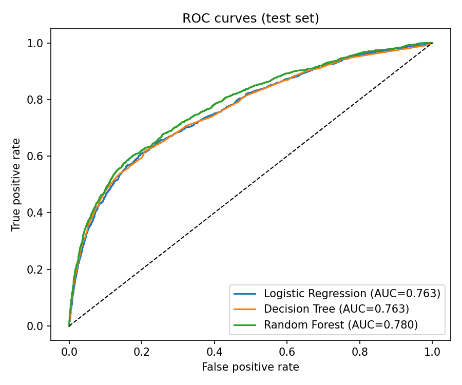
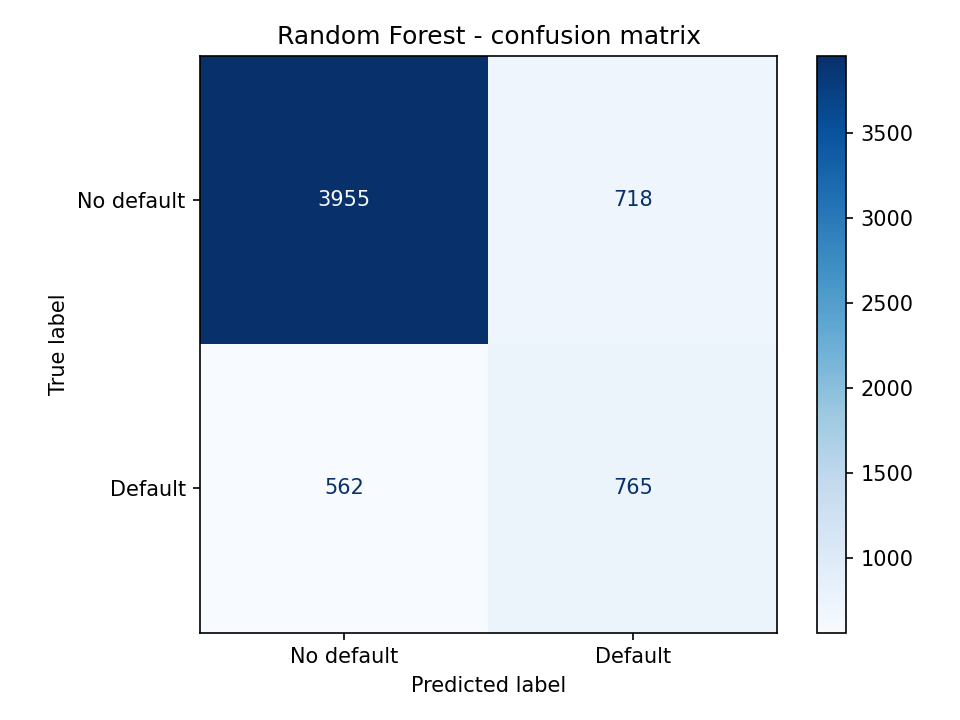
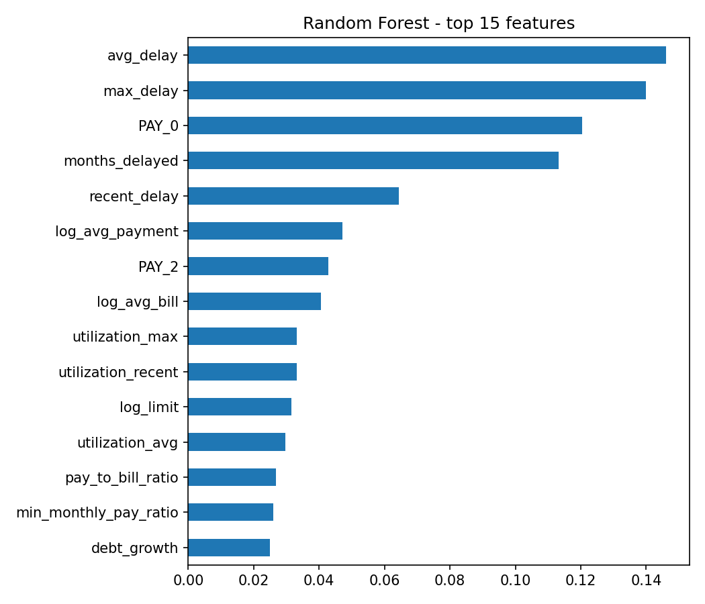

# CodeAlpha – Credit Scoring Model (ML Task 1)

Predict an individual's **creditworthiness** – will a credit-card client default on next month's payment? – from past financial data.

## Why
Lenders lose money when credit goes to people who cannot repay, and lose customers when good applicants are rejected. A credit-scoring model turns a customer's financial history into a probability of default, so decisions are consistent, fast and measurable.

## Dataset
**Default of Credit Card Clients** (UCI) – 30,000 clients, Taiwan, **22.1 % defaulted**
Kaggle: https://www.kaggle.com/datasets/uciml/default-of-credit-card-clients-dataset · UCI: https://archive.ics.uci.edu/dataset/350/default+of+credit+card+clients

Raw columns: credit limit, 6 months of repayment status (payment history), 6 monthly bill amounts (debt), 6 monthly payments, age, education.

## How it works
1. **Cleaning** – undocumented `EDUCATION` codes merged into "others".
2. **Feature engineering** – raw monthly records → credit-risk signals:

   | Group | Features |
   |---|---|
   | Payment history | recent delay, max delay, average delay, months late, delay trend |
   | Debt / utilisation | bill ÷ limit (recent, average, max), debt growth, log average bill |
   | Repayment capacity | total paid ÷ total billed, worst monthly payment ratio, zero-payment months |
3. **Fairness** – `SEX` and `MARRIAGE` are protected attributes and are **not** used.
4. **Models** – Logistic Regression, Decision Tree, Random Forest (scikit-learn Pipelines with scaling + one-hot encoding, class weights for the 78/22 imbalance).
5. **Validation** – 80/20 stratified split, 5-fold CV, Random Forest tuned with `RandomizedSearchCV` (best CV ROC-AUC 0.787).
6. **Decision threshold** – chosen to maximise F1 on *out-of-fold training predictions*; the test set is never used for tuning.
7. **Credit score** – default probability mapped to an illustrative 300–850 score with an APPROVE / HIGH RISK decision.

## Results (test set – 6,000 unseen clients)
| Model | Precision | Recall | F1-Score | ROC-AUC |
|---|---|---|---|---|
| Logistic Regression | 0.480 | 0.585 | 0.527 | 0.764 |
| Decision Tree | 0.528 | 0.534 | 0.531 | 0.763 |
| **Random Forest (tuned)** | **0.516** | **0.577** | **0.545** | **0.780** |

The tuned Random Forest is the best model (highest ROC-AUC and F1). See the feature-importance plot for which signals drive the predictions.

| ROC curves | Confusion matrix | Feature importance |
|---|---|---|
|  |  |  |

## Files
| File | Purpose |
|---|---|
| `CodeAlpha_CreditScoringModel.ipynb` | Main notebook (run on Kaggle, with all outputs) |
| `results/` | Metrics and plots from the run |
| `requirements.txt` | Python packages used |

## Run
**Kaggle:** File → Import Notebook → add the dataset as input → Run All.

**Tech:** Python · pandas · scikit-learn · matplotlib

*Built during the CodeAlpha Machine Learning Internship.*

← [Back to all projects](../README.md)
