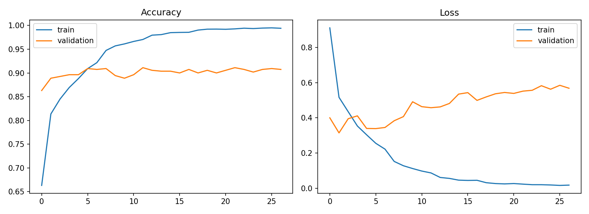
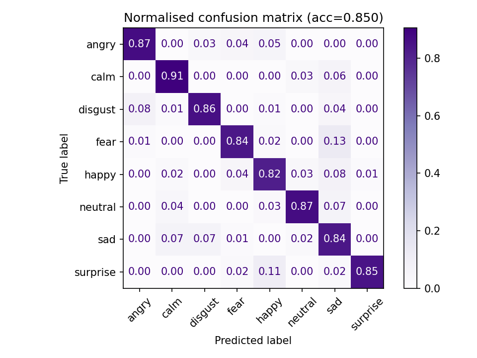
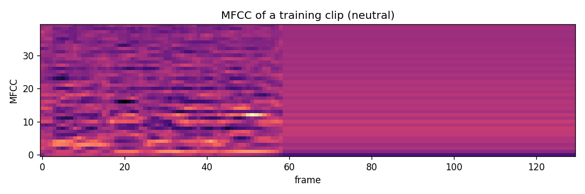

# CodeAlpha – Emotion Recognition from Speech (ML Task 2)

Recognise human emotions (neutral, calm, happy, sad, angry, fear, disgust, surprise) from speech audio with **MFCC features + a CNN-BiLSTM deep-learning model**.

## Why
Voice carries emotion through pitch, energy and rhythm, not just words. Speech emotion recognition is used in call-centre analytics, mental-health monitoring, voice assistants and human-robot interaction.

## Datasets
| Dataset | Clips | Speakers | Link |
|---|---|---|---|
| RAVDESS | 1,440 | 24 actors (12 M / 12 F), 8 emotions | https://www.kaggle.com/datasets/uwrfkaggler/ravdess-emotional-speech-audio |
| TESS | 2,800 | 2 speakers, 7 emotions | https://www.kaggle.com/datasets/ejlok1/toronto-emotional-speech-set-tess |

Labels are parsed from file names (RAVDESS `03-01-05-01-02-01-12.wav` → emotion 05 = angry, actor 12). Duplicate copies inside the Kaggle datasets are removed (4,239 unique clips).

## How it works
1. **Preprocessing** – resample to 22.05 kHz, trim silence, pad/crop to 3 s.
2. **Features** – 40 **MFCCs** + Δ + ΔΔ + RMS energy + zero-crossing rate → 130 frames × 122 features per clip.
3. **Augmentation** (training clips only) – noise, pitch shift, time stretch → 4× training data (12,156 samples).
4. **Normalisation** – per-feature mean/std from the training set only.
5. **Model** – 3 × [Conv1D → BatchNorm → ReLU → MaxPool → Dropout] learn spectral patterns; 2 × **Bidirectional LSTM** model how emotion evolves over time; softmax over 8 classes. Adam, class weights, early stopping, LR scheduling.
6. **Speaker-independent split** – RAVDESS actors **21–24 are never seen in training** (actors 19–20 = validation); TESS (only 2 speakers) is split randomly.

## Results
**Test accuracy: 85.0 %** on 660 test clips (chance = 12.5 %).
The test set contains 240 RAVDESS clips from 4 unseen actors and 420 TESS clips. Per-emotion precision / recall / F1 are in the notebook.

| Training curves | Confusion matrix |
|---|---|
|  |  |

## Files
| File | Purpose |
|---|---|
| `CodeAlpha_EmotionRecognitionFromSpeech.ipynb` | Main notebook (run on Kaggle GPU, with all outputs) |
| `results/` | Metrics and plots from the run |
| `requirements.txt` | Python packages used |

## Run
**Kaggle:** File → Import Notebook → Accelerator GPU → add RAVDESS (+ TESS) → Run All.

**Tech:** Python · librosa · TensorFlow/Keras · scikit-learn

*Built during the CodeAlpha Machine Learning Internship.*

← [Back to all projects](../README.md)
