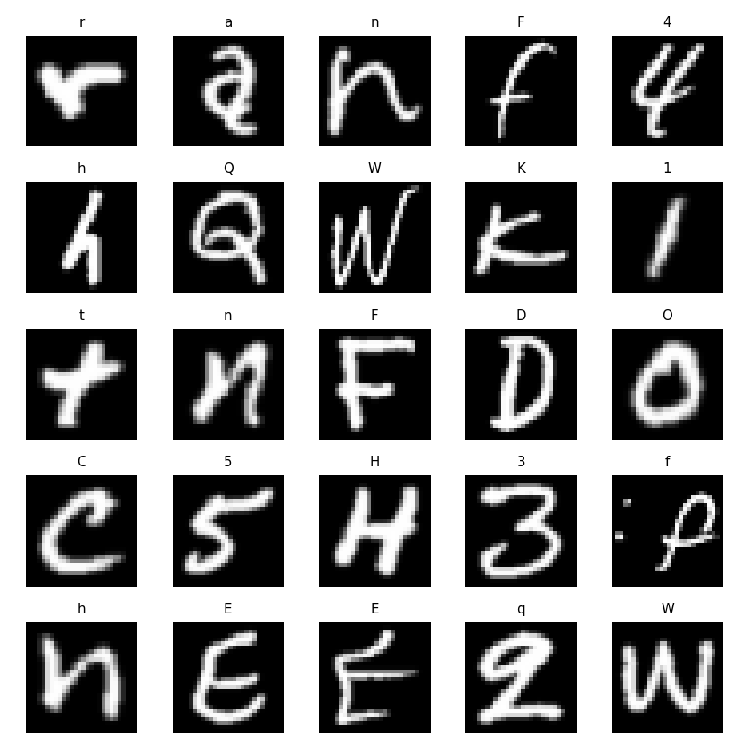
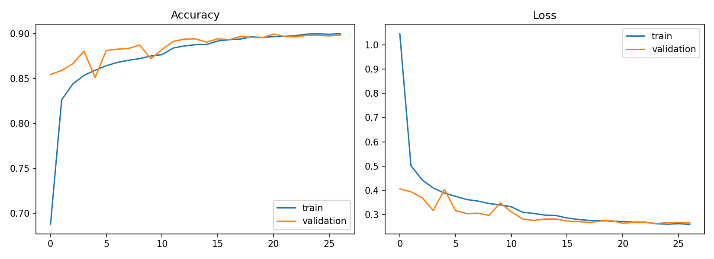
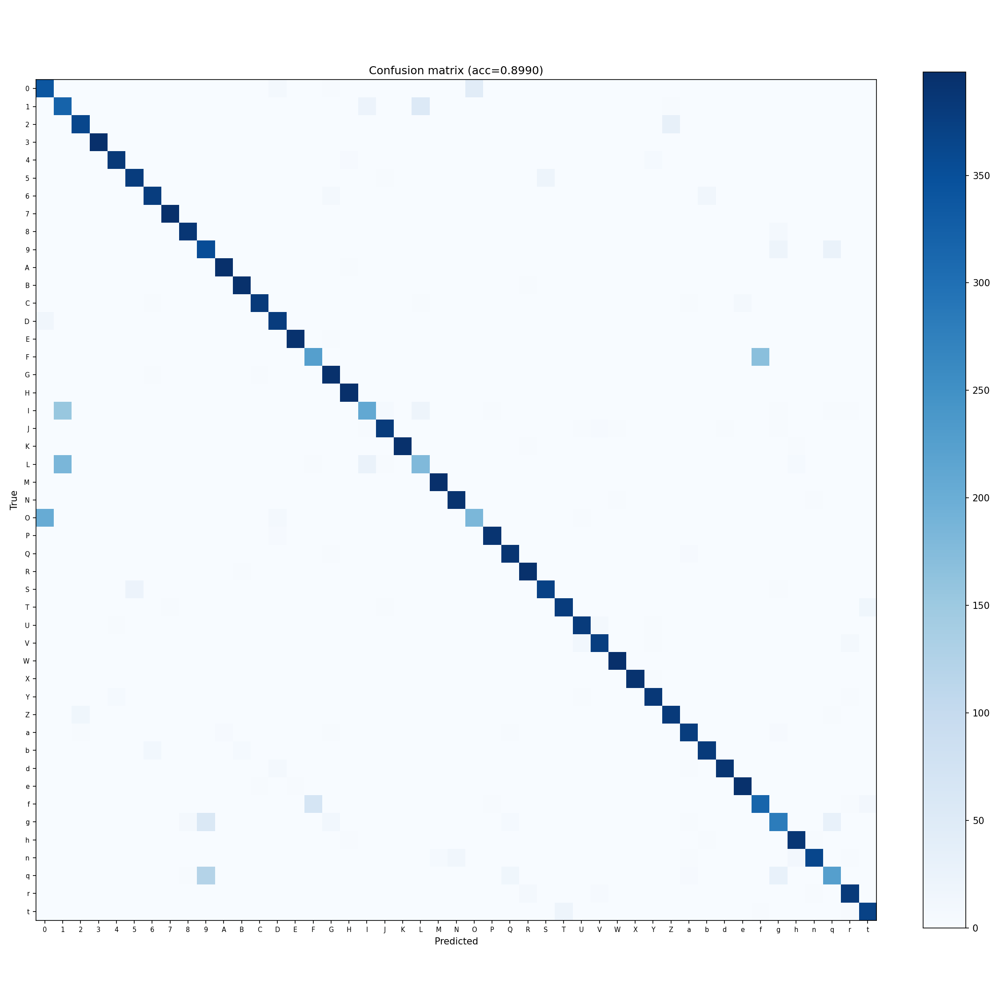
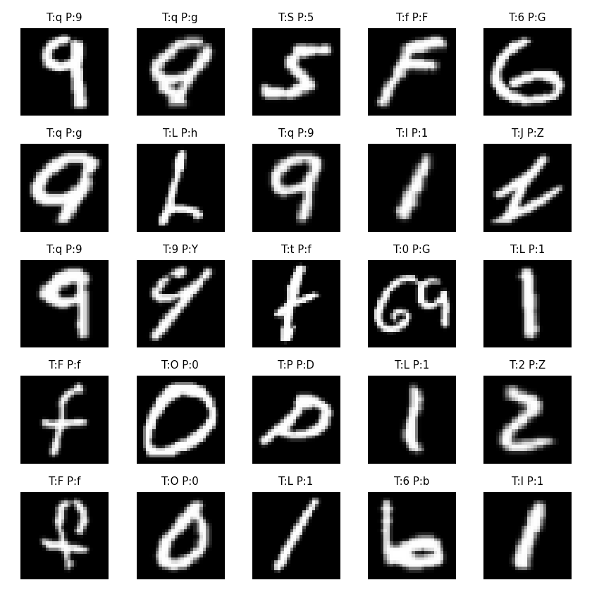
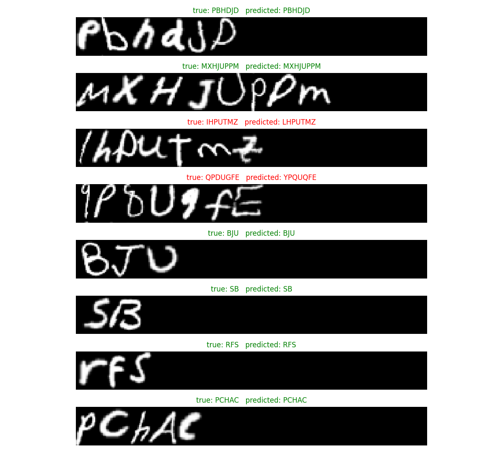

# CodeAlpha – Handwritten Character Recognition (ML Task 3)

Identify handwritten digits and alphabets with a **Convolutional Neural Network**, extended to full **word recognition with a CRNN (CNN + BiLSTM + CTC)**.

## Why
Handwriting recognition powers cheque processing, postal-code reading, form digitisation and note-taking apps. Characters vary a lot between writers, so a CNN that learns strokes and shapes directly from pixels works far better than hand-made rules.

## Dataset
**EMNIST Balanced** – 131,600 handwritten characters, **47 classes** (0-9, A-Z, and lowercase letters that look different from uppercase); 112,800 train / 18,800 test.
Kaggle: https://www.kaggle.com/datasets/crawford/emnist · NIST: https://www.nist.gov/itl/products-and-services/emnist-dataset

EMNIST images are stored transposed – the loader fixes the orientation:

## How it works
### Part A – Character CNN
- Pixels scaled to [0, 1]; on-the-fly **augmentation** (rotation, shift, zoom – no flips, they change characters).
- 3 convolutional blocks (2 × Conv3×3 → BatchNorm → ReLU, MaxPool, Dropout), 32 → 64 → 128 filters: edges → strokes → character parts; Dense(256) + Dropout; softmax over 47 classes.
- Adam, early stopping, learning-rate reduction.

### Part B – Word recognition (CRNN extension)
- Words of 1–8 letters are synthesised by joining random EMNIST letter images (train words from train letters, test words from **unseen** test letters).
- **CRNN**: CNN feature extractor → 64 image columns as a sequence → 2 × BiLSTM → **CTC loss**, which learns the character alignment without per-letter positions.

## Results
| Model | Task | Test result |
|---|---|---|
| CNN | 47-class character recognition (18,800 test images) | **89.9 % accuracy** |
| CRNN | word recognition (4,000 unseen words) | **5.5 % character error rate · 78.4 % exact-word accuracy** |

Most CNN errors are characters that are genuinely ambiguous in handwriting: **O ↔ 0, L ↔ 1, I ↔ 1, F ↔ f, q ↔ 9**.

| Training curves | Confusion matrix |
|---|---|
|  |  |

| Misclassified examples | CRNN word predictions |
|---|---|
|  |  |

## Files
| File | Purpose |
|---|---|
| `CodeAlpha_HandwrittenCharacterRecognition.ipynb` | Main notebook (run on Kaggle GPU, with all outputs) |
| `results/` | Metrics and plots from the run |
| `requirements.txt` | Python packages used |

## Run
**Kaggle:** File → Import Notebook → Accelerator GPU → add `crawford/emnist` → Run All.

**Tech:** Python · TensorFlow/Keras · scikit-learn · NumPy · Pillow

*Built during the CodeAlpha Machine Learning Internship.*

← [Back to all projects](../README.md)
