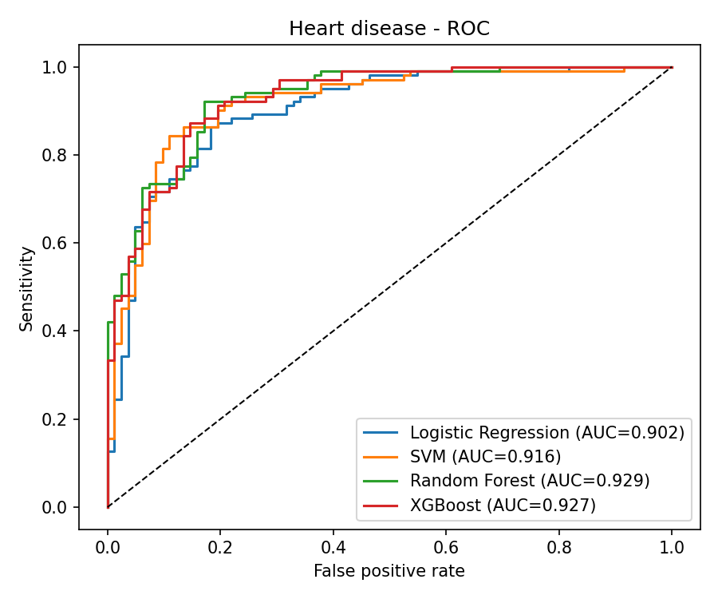
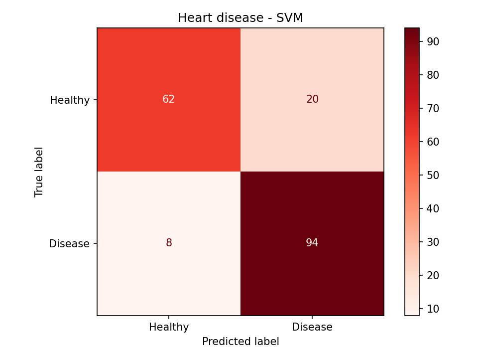
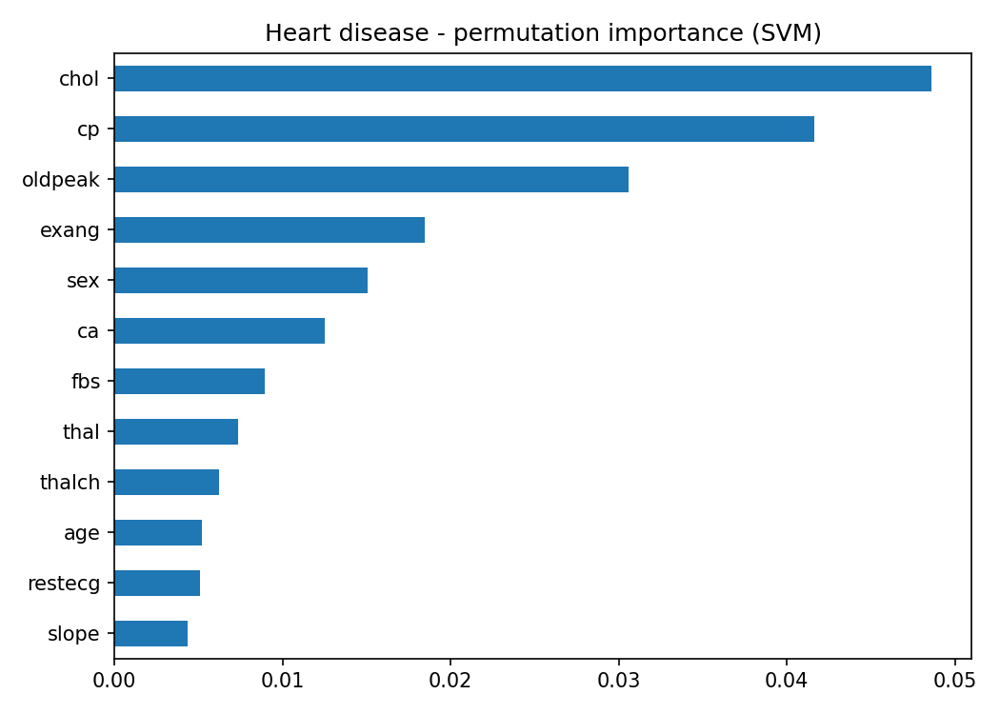
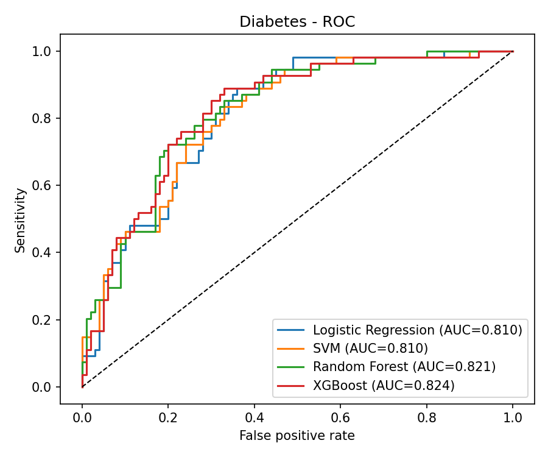
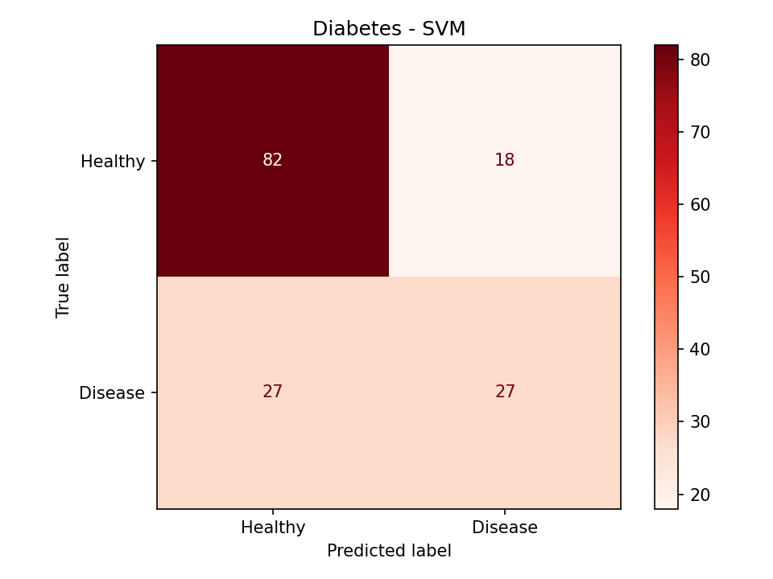
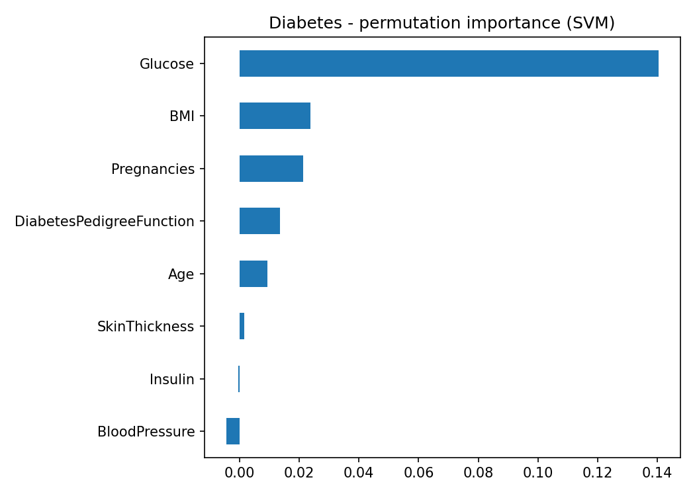
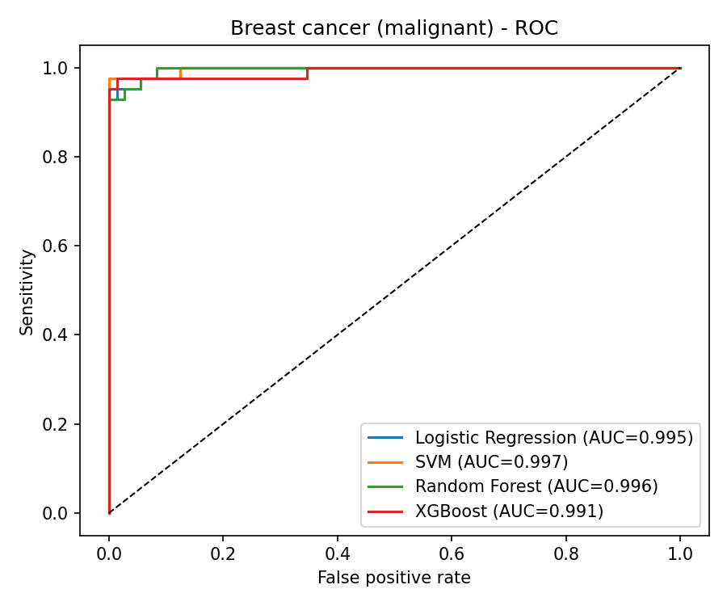
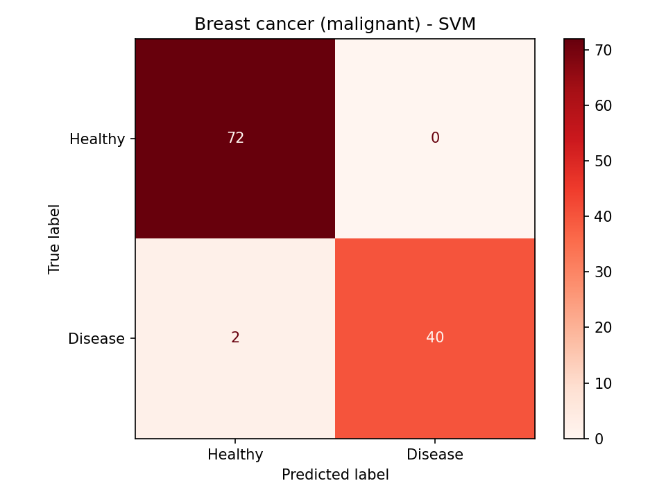
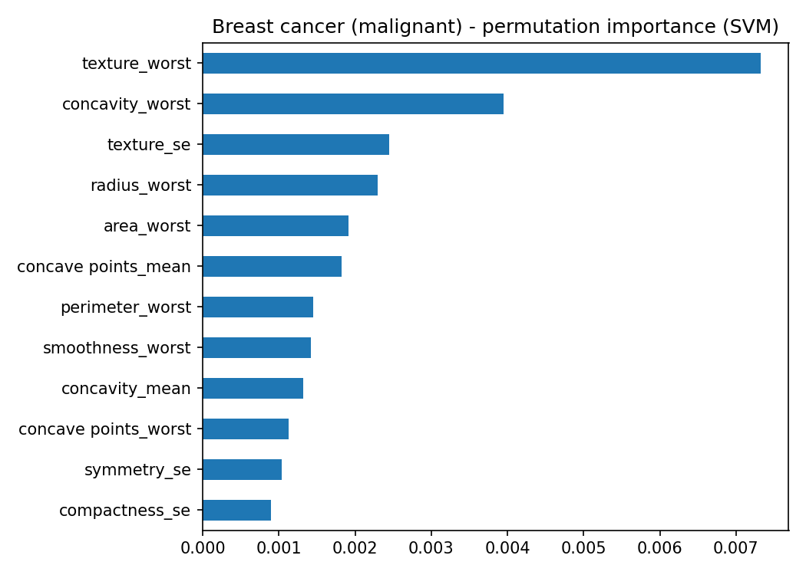

# CodeAlpha – Disease Prediction from Medical Data (ML Task 4)

Predict the possibility of a disease from structured patient data (age, symptoms, blood-test and clinical measurements) on **three** UCI medical datasets.

## Why
Early screening saves lives. A model that flags high-risk patients from routine measurements helps doctors prioritise further tests. In medicine a **missed patient (false negative) is the costly error**, so Recall (sensitivity) and ROC-AUC are reported alongside accuracy.

## Datasets
| Dataset | Patients | Target | Source |
|---|---|---|---|
| Heart Disease (UCI, 4 hospitals) | 920 | heart disease present (num > 0) | https://www.kaggle.com/datasets/redwankarimsony/heart-disease-data |
| Pima Indians Diabetes | 768 | diabetes | https://www.kaggle.com/datasets/uciml/pima-indians-diabetes-database |
| Breast Cancer Wisconsin (Diagnostic) | 569 | malignant tumour | https://www.kaggle.com/datasets/uciml/breast-cancer-wisconsin-data |

## How it works
1. **Data quality** – Pima zeros in Glucose, BloodPressure, SkinThickness, Insulin, BMI are impossible → treated as missing; heart dataset's text categories and missing values handled; binary targets created.
2. **Pipeline** (fitted on training folds only – no leakage): median / most-frequent imputation → standard scaling → one-hot encoding (chest-pain type, ECG, slope, thal …).
3. **Algorithms** – SVM, Logistic Regression, Random Forest, XGBoost, each tuned with `GridSearchCV` (5-fold stratified CV, ROC-AUC); class imbalance handled with class weights / `scale_pos_weight`.
4. **Model selection** by CV score; the 20 % hold-out test set is used once for the final honest estimate.
5. **Evaluation** – Accuracy, Precision, Recall, F1, ROC-AUC, ROC curves, confusion matrix, permutation feature importance.

## Results (hold-out test set, model selected by CV ROC-AUC)
| Dataset | Selected model | Accuracy | Precision | Recall | F1 | ROC-AUC |
|---|---|---|---|---|---|---|
| Breast cancer | SVM | **0.982** | 1.000 | 0.952 | 0.976 | **0.997** |
| Heart disease | SVM | 0.848 | 0.825 | **0.922** | 0.870 | 0.916 |
| Diabetes | SVM | 0.708 | 0.600 | 0.500 | 0.545 | 0.810 |

The full comparison of all four algorithms is in `results/<dataset>/model_comparison.csv`. On diabetes, XGBoost reached higher recall (0.778) and ROC-AUC (0.824) on the test set – the better choice when catching more patients matters more than precision.

| | ROC curves | Confusion matrix | Feature importance |
|---|---|---|---|
| Heart |  |  |  |
| Diabetes |  |  |  |
| Breast cancer |  |  |  |

## Files
| File | Purpose |
|---|---|
| `CodeAlpha_DiseasePrediction.ipynb` | Main notebook (run on Kaggle, with all outputs) |
| `results/` | Metrics and plots per dataset |
| `requirements.txt` | Python packages used |

## Run
**Kaggle:** File → Import Notebook → add the three datasets as input → Run All.

> Educational project – not a medical device and not a substitute for clinical diagnosis.

**Tech:** Python · scikit-learn · XGBoost · pandas · matplotlib

*Built during the CodeAlpha Machine Learning Internship.*

← [Back to all projects](../README.md)
